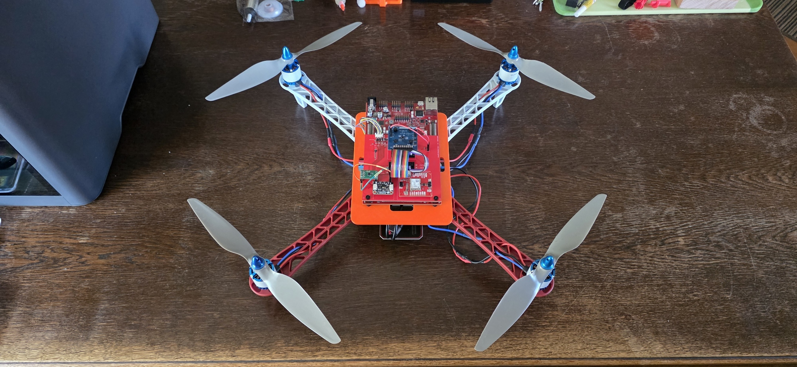
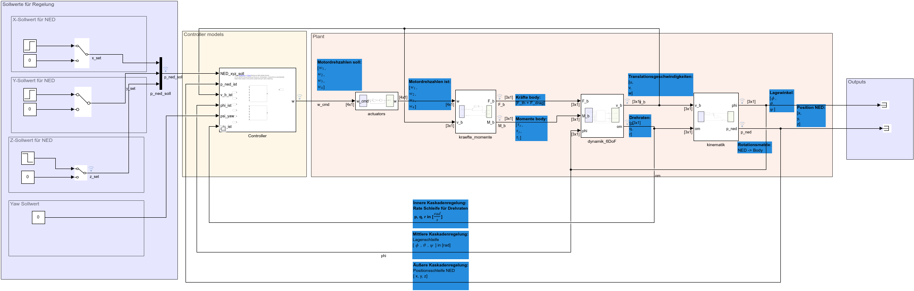

# Quadrocopter — Model-Based Flight Controller

A cascade flight controller for a 450-class quadcopter, built along the full
model-based design chain: **6-DoF Simulink model → C controller → SiL → PiL on
real target hardware** (Infineon AURIX TC399, 6× TriCore @ 300 MHz).

The controller itself is hand-written C99 (`sil/flight_ctrl.c`) and runs
**byte-identically** in three places: as a Simulink S-function, as a PC reference,
and on the TC399. That is what makes the comparison meaningful — the same
translation unit is compared against itself, not two reimplementations of the
same idea.

| Repository | Owns |
|---|---|
| **Quadrocopter** (here) | Simulink 6-DoF model, controller design, MiL / SiL / PiL verification |
| [**AurixTricore**](https://github.com/crengineering/AurixTricore) | TC399 firmware, drivers, XCP memory map, replay protocol |
| [**AurixGUI**](https://github.com/crengineering/AurixGUI) | Qt6 measurement and calibration GUI |



*The aircraft as built: F450 frame, SunnySky X2216-III 880 KV motors with
HQProp 254 mm propellers, the TriBoard TC3X9 flight stack on a 3D-printed
adapter plate, the 4-in-1 ESC underneath. The propellers are fitted for the
photo only — the aircraft has not flown yet.*

---

## Documentation

The three documents under `doc/` are the knowledge base for this project. They
were written while building it and carry the derivations, the design decisions
and the failures behind them.

| Document | Contents |
|---|---|
| **[Flugdynamik eines Quadrocopters](doc/quadcopter-6dof-simulink_5.html)** | The plant, from first principles: coordinate frames and the 12 states, rotor model and mixer, the Newton–Euler equations in the body frame, step-by-step Simulink construction, open-loop verification, trim and linearisation, the cascade architecture, closed-loop acceptance tests |
| **[Trimmung, Linearisierung & Reglerentwurf](doc/trimm-regler.html)** | The design reference: how each of the three loops is dimensioned, the resulting gains, the conversion from commanded acceleration to commanded attitude, and the failure symptoms of getting it wrong |
| **[Vom Modell aufs Target](doc/vom-modell-aufs-target.html)** | The path onto the hardware: MiL suite, s- to z-domain, the C code, wrapping it back into the model, and the vector replay on the TC399 |

They are self-contained HTML — open them in any browser, no MATLAB required.

*On authorship: these documents were written with Claude Code from the model, the
design decisions and the measured results of this project, then reviewed and
corrected against the working model. The engineering is mine; the write-up was
drafted with a tool.*

---

## Control structure

Three nested loops, each outer loop roughly three to five times slower than the
one inside it. All stages run at **Ts = 1 ms (1 kHz)**.

```
          ┌───────────────────────────────────────────────────────────────────┐
          │                      POSITION  PD    ωc ≈ 1,2 rad/s               │
          │  ┌─────────────────────────────────────────────────────────────┐  │
          │  │                  ATTITUDE  P     ωc ≈ 3 rad/s               │  │
          │  │  ┌───────────────────────────────────────────────────────┐  │  │
          │  │  │              BODY RATE  PI    ωc ≈ 10 rad/s           │  │  │
p_soll ─▶─┴──┴──┴─▶ e ─▶ [PD] ─▶ [P] ─▶ [PI] ─▶ [MIXER] ─▶ w_cmd[4] ─▶ PLANT ─┬─▶ p_ned
                          │       │       │                                   │
                          │       │       └── om  ◀───────────────────────────┤
                          │       └────────── phi ◀───────────────────────────┤
                          └────────────────── p_ned, v_b ◀────────────────────┘
```

**Bandwidth separation 1,2 → 3 → 10 rad/s is a precondition, not a convention.**
Only when the inner loop is distinctly faster may the outer loop treat it as
ideal (unity gain) during design. Otherwise the outer loop commands setpoints the
inner one has not yet reached, and the two wind each other up. The motors, with a
pole at −20 rad/s, are what permits the fast inner loop.

[](doc/img/quad_model_control.png)

*Top level of `quad_model_control.slx`. Setpoints on the left, the `Controller`
subsystem holding the four cascade stages, and the plant as `actuators` →
`kraefte_momente` → `dynamik_6DoF` → `kinematik`. The three feedback paths at the
bottom are the rate, attitude and position loops. Click to open full size.*

### Loop dimensioning

**Inner — body rate (PI).** Per axis the plant is a pure integrator, since
ω̇ = M / I. For G(s) = 1/(I·s) under P control the crossover is ωc = Kp / I, so
Kp = ωc · I. The I-term covers steady disturbance torques, its zero placed near
ωc / 8. No D-term — the plant already integrates.

| Axis | Inertia [kg m²] | Kp | Ki | Actuator limit |
|---|---|---|---|---|
| Roll (p) | 0,010 | 0,100 | 0,125 | ± 1,30 Nm |
| Pitch (q) | 0,010 | 0,100 | 0,125 | ± 1,30 Nm |
| Yaw (r) | 0,018 | 0,216 | 0,324 | ± 0,08 Nm |

Yaw carries higher gains because its inertia is larger — which keeps the
bandwidth equal across all three axes. Its tight limit follows from weak yaw
authority, τ_z,max = 2·kQ·(w_max² − w_hover²) ≈ 0,085 Nm with the placeholder
drive the loops were designed for (roughly twice that with the measured drive —
the re-tune is an open item). Anti-windup is by clamping, because the motors saturate; without it the integrator charges up at
the limit and blocks the controller for seconds afterwards.

**Middle — attitude (P).** With the rate loop treated as ideal and Φ̇ ≈ om, the
attitude controller again sees a pure integrator, so Kp = ωc outright. **Kp = 3,0
on all three axes** — the inertia is already accounted for in the subordinate rate
loop. No I-term: the plant integrates and the inner loop is already accurate in
steady state.

**Outer — position (PD).** Here the plant is a double integrator — attitude
produces acceleration, which is integrated twice. Pure P control would oscillate
undamped, exactly the 0 ± 1,6j mode from the linearisation, so the D-term is
mandatory.

| Axis | Kp | Kd | Actuates | Damping from |
|---|---|---|---|---|
| x (forward) | 1,44 | 1,92 | pitch θ | v_b(1) |
| y (lateral) | 1,44 | 1,92 | roll φ | v_b(2) |
| z (altitude) | 2,70 | 2,50 | thrust T | v_b(3) |

### Two decisions that earned their place

**The D-term is taken from the measurement, not from the error.** Applied to the
error, it differentiates the step edge of a setpoint change. In this cascade that
impulse produced up to **19 rad of commanded attitude, 58 rad/s of commanded rate
and 6 Nm of torque demand** — hitting every limit, charging the integrator and
delaying settling by seconds. Damping taken from measured velocity cannot produce
that effect by construction.

**Divide by actual specific thrust T/m, not by g.** The position controller
outputs a commanded acceleration; the attitude loop wants an angle. Inverting the
coupling gives

```
θ_soll = − ẍ_soll / (T / m)          ⎡ φ ⎤   ⎡  0   1 ⎤ ⎡ ẍ_soll ⎤
φ_soll = + ÿ_soll / (T / m)          ⎣ θ ⎦ = ⎣ −1   0 ⎦ ⎣ ÿ_soll ⎦
```

with T the current thrust from the altitude controller. When the copter tilts,
thrust loses vertical component, the altitude controller pushes more total thrust
— and that extra thrust simultaneously amplifies the horizontal force. Under the
1/g approximation the overshoot in coupled 3D flight rose from **7 % to 22 %**.
Dividing by T/m removed it almost entirely. Real flight stacks use the same
formulation.

### Conventions

Identical in model, C code and firmware:

| Quantity | Meaning | Unit |
|---|---|---|
| **NED** | z points down, altitude = −z | — |
| `phi` | `[roll, pitch, yaw]` | rad |
| `om` | body rates `[p, q, r]` | rad/s |
| `v_b` | velocity in the body frame | m/s |

Plant parameters in `quad_params.m`: m = 1,20 kg, l = 225 mm, Ixx = Iyy =
1,0e-2 kg m², Izz = 1,8e-2 kg m², X configuration. The propulsion constants
are measured, not assumed — see
[Propulsion identification](#propulsion-identification).

---

## Verification chain

Three stages, each catching a different class of error.

### 1. MiL — model against physics

Plain Simulink, **without the Aerospace Blockset** — the rigid-body dynamics are
built by hand.

Checks: are signs, axes and conservation laws right? Eight tests in `tests/`, run
via `run_all_tests`:

| Test | Checks |
|---|---|
| T1 free fall | with no thrust and no drag the plant integrates exactly g |
| T2 hover | trim thrust holds altitude |
| T3 climb | 1,05·w_hover gives about 1,0 m/s² upward in steady state |
| T4 roll | M3/M4 faster ⇒ p > 0 and phi > 0 (roll right) |
| T5 pitch | M1/M4 (front) faster ⇒ q > 0 and theta > 0 (nose up) |
| T6 yaw | CCW motors M1/M3 faster ⇒ r > 0 and psi > 0 (nose right) |
| T7 angular momentum | with an initial yaw rate and no torque, r stays constant |
| T8 energy | frictionless, ½v² must match the drop height g·h |

Trim and linearisation about hover: `linearize/linearize_hover.m`. The design that
follows from it is documented in [`doc/trimm-regler.html`](doc/trimm-regler.html).

### 2. SiL — C code against model

`sil/build_sfun.m` wraps the C controller through **`legacy_code`** into four
S-function blocks (`sfun_pos_ctrl`, `sfun_att_ctrl`, `sfun_rate_ctrl`,
`sfun_mixer`) and compiles them with `mex`. The blocks replace the Simulink
controller stages and run against the same 6-DoF plant.

Checks: does the hand-written C behave like the design — including saturations,
anti-windup and float precision (`real32_T`, single)?

The rate controller is deliberately stateless: the integrator state goes in as an
input and comes back out as an output, and a Unit Delay (Ts, IC = 0) closes the
loop inside the model. That keeps the same C code free of hidden static state on
the target.

Requires a configured MinGW compiler (`mex -setup C`).

### 3. PiL — target hardware against SiL

`pil/run_pil.m` is a **vector replay** over UDP against the TC399 — not Embedded
Coder PiL, but a purpose-built reproducible harness:

```
run_pil()
  |
  |- 1. quad_run()        simulate the model (C-code variant)
  |- 2. replay_export()   extract input and reference vectors
  |- 3. replay_udp()      step by step to the target, collect the responses
  |- 4. replay_compare()  channel-wise against tolerance + timing evaluation
```

The wire protocol (UDP 5556) is implemented and maintained on the ECU side —
framing, field order and the statistics request are documented in
[`AurixTricore/docs/CTRL_REPLAY.md`](https://github.com/crengineering/AurixTricore/blob/main/docs/CTRL_REPLAY.md).
The MATLAB side here only speaks it: `replay_udp.m` sends the input vectors and
collects the responses together with the execution-time tick value the target
returns.

Per-group tolerances live in `pil/replay_compare.m`, ranging from 1e-5 Nm on the
commanded torques to 1e-2 rad/s on the motor speeds.
They can be overridden per run through `run_pil`.

One detail that saved real work: Simulink logs the integrator state as `I[k-1]`
while the target reports `I[k]`. Without the shift (`ShiftTauI`, default `true`),
a correct controller looks like a failure.

---

## Propulsion identification

The drive was decided in one gate — F450 frame with l = 225 mm, SunnySky
X2216-III 880 KV on 4S, HQProp 10×4,5″ (Ø 254 mm) — and then **measured** on a
single-motor thrust rig rather than taken from datasheets: a printed stand on a
0,1 g scale, the motor on one channel of the flight ESC, throttle stepped over
XCP from the groundstation and held per step, rpm from the ESC's bidirectional
DShot reply, voltage and current from the supply. Five runs; the first two
found an ESC setting (low-RPM power protect scaled by a wrong stored KV) and a
propeller mounted against its direction before the curve was valid.

| Quantity | Value | Source |
|---|---|---|
| kT (thrust, T = kT·ω²) | 1,16e-5 N/(rad/s)² secant at hover; LS fit 1,20–1,25e-5, exponent ≈ 2,2 | runs 3 and 5, lab supply and flight pack |
| hover point | 503 rad/s (4806 rpm), 300 g per motor | trim from kT and m |
| full throttle, one motor on the pack | 1410 g at 9886 rpm, 17,6 A | run 5 |
| w_max (rotor-speed ceiling) | 865 rad/s = DShot 1600 — keeps four motors under 50 A | run 5, current vs rpm |
| kQ (torque) | 1,66e-7 Nm/(rad/s)² — **estimate** from electrical power at η ≈ 0,7 | open until a torque measurement |
| τ (motor + ESC) | 0,05 s — **placeholder** | open: step response from the 1 kHz eRPM |

The fit lives in `analysis/` (`fit_motor_coeffs.m` with its own test;
`propulsion_rig_run3.m` parses the run log so that no number is retyped). The
mixer inverse `MIX_inv` is unrolled in `sil/flight_ctrl_lct.c` and in the
firmware's replay endpoint — kT, kQ and w_max change in all three places
together, never in one.

## Mechanics

`mech/` holds the approved snapshots of the mechanical design; the working copy
lives in Autodesk Fusion. A bought F450 kit carries the aircraft, the parts
that carry the electronics are printed in PETG on a Bambu Lab X2D: the TriBoard
adapter plate with the board's non-rectangular, semi-kinematic hole pattern,
and the thrust stand above. `mech/README.md` records the decisions and the
versioning rule, `mech/drafts/` the STEP/STL/3MF exports with their notes.

---

## Quick start

Requires MATLAB / Simulink and MinGW-w64 for `mex`. The PiL run additionally
needs a TC399 running the firmware from `AurixTricore`.

```matlab
startup                      % put the project folders on the path

run_all_tests                % MiL test suite T1-T8

cd sil; build_sfun; cd ..    % build the S-functions from the C code

res = run_pil();                                  % PiL against the hardware
res = run_pil('StopTime', 5, 'MaxTakte', 2000);   % short run
```

---

## Repository layout

```
quad_model.slx            plant (6-DoF)
quad_model_ST.slx         MiL harness — references quad_model, used by all tests
quad_model_control.slx    closed loop: cascade with the SiL S-functions + plant
quad_params.m             parameter set (single source of truth)
quad_run.m                simulation run with reproducible configuration
code_config.m / .mat      exported ConfigSet (solver, codegen options)
startup.m                 path setup
linearize/                trim + linearisation about hover
sil/                      C controller + legacy_code wrappers
  flight_ctrl.c/.h          the controller, identical to the TC399 firmware
  flight_ctrl_lct.c/.h      thin adapter for legacy_code
  build_sfun.m              builds the four S-functions
  s_functions.slx           masked blocks for copying into a model
tests/                    MiL suite T1-T8 + run_all_tests
pil/                      vector replay harness against the TC399
analysis/                 thrust-rig fits: fit_motor_coeffs.m (+ test), propulsion_rig_run3.m
mech/                     mechanical design snapshots (adapter plate, thrust stand), params JSON
doc/                      the three reference documents (HTML), MBD_PATH.md,
                          PROP_TO_FIRMWARE.md, projektplan.md
```

---

## Status

**Done**

- [x] 6-DoF rigid-body model built by hand, without the Aerospace Blockset
- [x] Parameter set and reproducible solver / codegen configuration
- [x] MiL suite T1-T8: signs, angular-momentum and energy conservation
- [x] Trim + linearisation about hover, controller design documented
- [x] Cascade controller in C99: position PD, attitude P, rate PI, mixer
- [x] Anti-windup and saturations in the C code, stateless rate controller
- [x] Damping taken from measured velocity instead of the error derivative
- [x] Commanded angle from actual specific thrust T/m instead of the 1/g
      approximation — coupled-flight overshoot from 22 % back to about 7 %
- [x] SiL: four `legacy_code` S-functions, verified in the closed model
- [x] PiL: UDP vector replay against the TC399, channel-wise tolerance check
- [x] Execution time on target: **3,9 µs per cycle** against a 1 ms budget
- [x] Controller code byte-identical across Simulink, PC and target hardware
- [x] Drive decided and **measured**: kT from a single-motor thrust rig, the
      rotor-speed ceiling from the measured current, both mirrored into the
      model and the PiL replay parameter set
- [x] Airframe built: F450 frame, printed TriBoard adapter plate, flight stack
      and ESC mounted
- [x] Test stage 0 passed on the target: DShot300 driver, arming and kill chain
      verified without propellers (in `AurixTricore`)

**Open**

- [ ] **Sensor models** — noise, bias, drift and sample rates for IMU, baro,
      magnetometer and GNSS. Today the controller is fed the true plant states
      directly; that is the largest remaining gap to reality.
- [ ] **State estimator in the model** — the firmware already runs one
      (quaternion Mahony AHRS plus three Kalman channels); its Simulink twin,
      needed to close the loop in simulation and to verify the firmware
      through the replay chain, is the work package in
      [`doc/MBD_PATH.md`](doc/MBD_PATH.md)
- [ ] **Closed loop with the estimator** — stability under realistic sensors
- [ ] **Re-tune against the measured drive** — gains, the yaw torque limit and
      the inertias still come from the placeholder parameter set; kQ and τ are
      an estimate and a placeholder (torque from a reaction arm, τ from the
      1 kHz eRPM step response)
- [ ] **RPM notch filter** from the bidirectional-DShot speed feedback
- [ ] **Ball-joint rig disturbance model** — pendulum term M = m·g·d·sin(phi)
      for test stage 1
- [ ] **Commit a reference run** — a stored PiL result as a regression baseline
- [ ] **CI** — run the MiL suite automatically; today it is manual only

How the propeller choice reaches the flight firmware (blade-pass frequency →
required sample rate) is written down in
[`doc/PROP_TO_FIRMWARE.md`](doc/PROP_TO_FIRMWARE.md).

Test stages up to flight, each with its own safety concept: **0** motors on the
rig without propellers (DShot, arming, kill) — *passed* → **1** ball-joint rig
(rate + attitude) → **2** tethered over grass (altitude hold) → **3** free
flight, attitude stabilised → **4** position hold with GNSS.

---

## Safety notice

Private engineering project, not a product. Nothing here is functionally safe,
certified, or qualified to any aviation or automotive standard.

This repository contains flight-control code for an aircraft with **freely
spinning propellers**. If you run it on real hardware: **remove the propellers**,
secure the frame, keep the battery disconnected until the last moment, test the
kill path first — and understand that you do so entirely at your own risk. Never
reach into spinning propellers. The warranty and liability disclaimer in
[`LICENSE`](LICENSE) applies.

---

## License

[MIT](LICENSE) © 2026 Chris Riedl — for everything in this repository: models,
MATLAB scripts, C sources, tests and documentation. No third-party code is
vendored here. Details on the tools that are *not* redistributed, on the
generated `.mexw64` binaries, and the trademark notice: [NOTICE.md](NOTICE.md).

MATLAB®, Simulink® and Embedded Coder® are registered trademarks of The MathWorks,
Inc. and are **not** shipped with this repository; they are licensed separately.
AURIX™ and TriCore™ are trademarks of Infineon Technologies AG. All such names are
used descriptively and imply no affiliation with, or endorsement by, those
companies.
